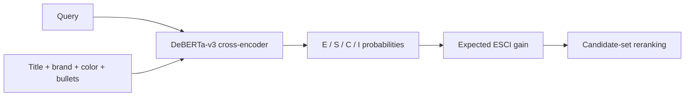

# Reliability-First Semantic Search Ranking

GPU-accelerated semantic query-product reranking on the official Amazon Shopping Queries ESCI relevance benchmark.

## Final official held-out test result

| Metric | Frozen lexical | Semantic reranker | Change |
| --- | --- | --- | --- |
| nDCG@10 | 0.685705 | 0.804019 | +0.118314 |
| Top-1 E/S precision | 85.14% | 92.71% | +7.57pp |
| Top-1 irrelevant rate | 9.99% | 5.57% | -4.42pp |
| Four-class macro F1 | N/A | 0.548303 | N/A |

## What this project demonstrates

- A transparent lexical comparator frozen before semantic training.
- Query-disjoint development validation using only official train rows.
- A pinned `microsoft/deberta-v3-base` revision: `8ccc9b6f36199bec6961081d44eb72fb3f7353f3`.
- A four-class Exact / Substitute / Complement / Irrelevant cross-encoder.
- One official held-out test evaluation after the development gate passed.
- Closed model selection after final evaluation.

## Architecture

## Paired-query uncertainty evidence

| Metric | Point estimate | 95% paired-query bootstrap CI |
| --- | --- | --- |
| nDCG@10 | +0.118314 | [+0.113828, +0.122670] |
| Top-1 E/S precision | +7.57pp | [+6.74pp, +8.40pp] |
| Top-1 irrelevant rate | -4.42pp | [-5.09pp, -3.83pp] |

## Claim boundary

This is an offline candidate-set semantic reranking result on static ESCI relevance labels. It does not claim production deployment, CTR lift, conversion lift, advertising causality, or end-to-end retrieval quality.

## Reproducibility anchors

- ESCI source commit: `7916cdf6ab75a462e77f20ab40428a10923998d5`
- Official-test receipt SHA-256: `19b714a0a716ba346baa6a7159e235098620494e79ebde5d16dedaa399514fb3`
- Final model SHA-256: `af4c95979eeed6932dcc2d90725ff853b0e03a1b36c04d5b4272a2902e3d80ad`
